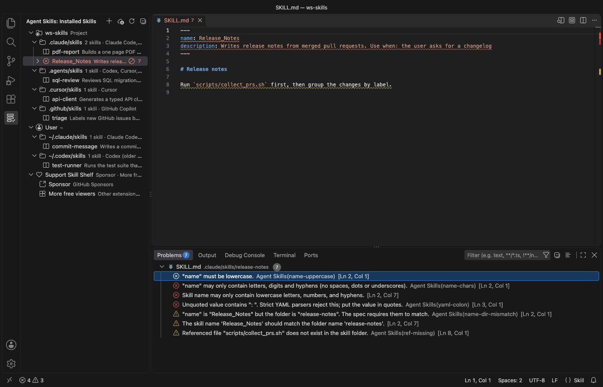
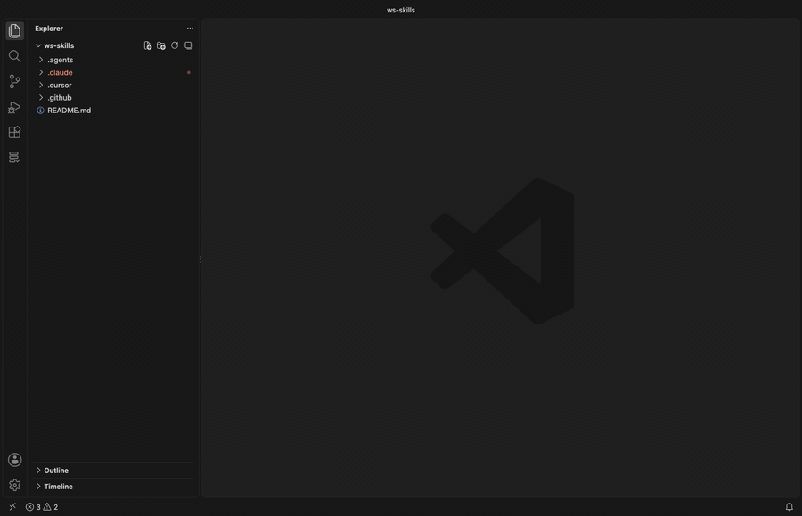

# Agent Skills & Claude Skills (Skill Shelf)

For people who write skills for Claude Code, Codex, Cursor, Copilot or Windsurf, Skill Shelf shows every `SKILL.md` those agents can load in one tree and flags the ones an agent will choke on.



*A real VS Code 1.142 window running this extension on a generated sample project (5 project skills in 4 folders, 2 user skills, one broken `SKILL.md`). Nothing in it was edited.*

- See which skills each agent picks up across 23 known folders, for the project and your home folder, without opening ten dot-folders by hand.
- Catch the mistakes that make an agent skip a skill, like an uppercase `name`, an unquoted `Use when:` in YAML, or a missing `scripts/` file, with line numbers in the Problems panel.
- Turn a skill off, copy it to another agent, create a new one, or install and share `.skill` files in a click. Nothing is deleted, and it all works offline.

## Quick start

1. Install Skill Shelf and open a folder. Click the shelf icon in the Activity Bar to see your skills.
2. Expand a skill with a red icon and click a problem to jump to that line. Right-click any skill to disable, enable or copy it.



*Recorded in the same window. The white arrow is drawn in to show where each click lands.*

## Which folders it reads

The view groups skills under Project (each workspace folder) and User (your home folder). Each folder is labelled with the agents that read it.

| Folder (project) | Folder (user) | Read by |
|---|---|---|
| `.claude/skills` | `~/.claude/skills` | Claude Code; Cursor (compatibility folder); GitHub Copilot (project only) |
| `.agents/skills` | `~/.agents/skills` | Codex, Cursor, GitHub Copilot, Devin, plus Gemini CLI, OpenCode and Amp in projects |
| `.cursor/skills` | `~/.cursor/skills` | Cursor |
| `.github/skills` | `~/.copilot/skills` | GitHub Copilot |
| `.codex/skills` | `~/.codex/skills` | Cursor (compatibility folder); older Codex versions (user folder) |
| `.windsurf/skills` | `~/.codeium/windsurf/skills` | Windsurf |
| `.devin/skills` | `~/.config/devin/skills` | Devin |
| none | `~/.gemini/skills`, `~/.config/opencode/skills`, `~/.config/agents/skills` | Gemini CLI, OpenCode, Amp |
| `.junie/skills`, `.roo/skills`, `.kiro/skills` | `~/.junie/skills`, `~/.roo/skills`, `~/.kiro/skills` | Junie, Roo Code, Kiro |

These paths come from each agent's documentation and from the `skills` CLI agent table, checked on 2026-11-05. Agents move their folders now and then. Add any folder this list misses with `agentSkills.extraLocations`, for example a monorepo package's `.claude/skills`.

Hover a skill to see its full description, its path and its symlink target. Click it to open `SKILL.md`.

## Finding a skill

Click the search icon at the top of the view, or run "Agent Skills: Find Skill…". One search box covers every skill in every project and user folder. It matches the name, the description, the folder and the agents that read it, so typing `pdf` or `cursor` narrows the list as you type. Each row shows where the skill lives and how many errors and warnings it has.

Press Enter to open `SKILL.md`. The two buttons on a row open the rendered Markdown preview or select the skill in the tree. "Preview SKILL.md" is also in the right-click menu of every skill.

## What it checks

Problems show in the tree. For workspace skills they also go to the Problems panel, with line numbers.

- Frontmatter has to exist and be closed. YAML errors are reported, including the common unquoted `description: Use when: …` that strict YAML parsers reject.
- `name` is required, at most 64 characters, lowercase letters, digits and single hyphens, and it should match the folder name.
- `description` is required, not empty, and at most 1,024 characters. `compatibility` is at most 500 characters, and `metadata` is a map of text values.
- File references in Markdown links, images and reference definitions, plus `scripts/…`, `references/…` and `assets/…` paths in the text, must exist in the skill folder. Links that leave the folder (`../`) get a note.
- It also flags a folder without `SKILL.md`, a lowercase `skill.md`, an empty body, a body over 500 lines (the spec's guideline) and broken symlinks.

Fields outside the [Agent Skills specification](https://agentskills.io/specification), such as Claude Code's `disable-model-invocation`, show as notes, not errors.

## Managing skills

- Disable and Enable move the skill folder to a hidden sibling folder (`.claude/skills/x` to `.claude/.disabled-skills/x`) and back, after a confirmation that shows both paths. No agent scans that folder, and nothing is deleted.
- Copy Skill To… copies a skill to any other project or user folder. Copy `~/.claude/skills/pdf-tools` into this repo's `.agents/skills` and Codex and Cursor pick it up too. The copy never overwrites, skips `.git`, and copies at most 2,000 files or 50 MB.
- Create Skill… asks for a folder, a name and a description, then writes a `SKILL.md` that passes the checks.
- Reveal in File Explorer and Open SKILL.md do what they say.

## Sharing skills as .skill files

A `.skill` file is a ZIP archive with the skill folder inside, the format Claude's skill packager writes and claude.ai accepts for upload. A `.zip` with the same layout works too.

- Export Skill as .skill File… (right-click a skill) writes `<name>/SKILL.md` and the rest of the folder into one file you can send to a teammate or upload to claude.ai. It leaves out the same files Copy leaves out (`.git`, secret-looking files and symlinks that point outside the skill) and lists them.
- Install Skill from .skill or .zip File… (right-click the file in the Explorer, the `…` menu of the view, or a skills folder in the tree) shows which skills the file holds, how many files each has and any SKILL.md errors. You choose the folder, so one bundle can go to Claude Code, Codex or Cursor. After a confirmation it writes the files.
- Install never overwrites a skill that exists, and if one name clashes nothing is written. Paths that leave the target folder (`../`), absolute paths, links, password-protected archives and files over 50 MB are refused. A bundle with several skills lets you pick which ones to install.

## Installing skills from GitHub

Install Skills from GitHub… asks for a repository (`owner/repo`, `owner/repo@tag` or a `https://github.com/…` URL), the agents and the scope. Then it shows the exact [`skills` CLI](https://github.com/vercel-labs/skills) command. Here is one example.

```
npx -y skills add vercel-labs/agent-skills -a claude-code -a cursor -g
```

Skill Shelf never runs it for you. Copy Command puts it on the clipboard, and Paste in Terminal types it into a new terminal without pressing Enter, so you read it and run it yourself. The tree refreshes when you close that terminal. Pick "Only list the skills in this repository" to preview a repository with `--list` first.

The repository and skill names are limited to letters, digits and `. _ - /`, so the command can't carry shell syntax. The `skills` CLI needs Node.js 22.20 or newer. Skills can include scripts that your agent may run, so read a repository before you install from it.

## Safety

- The extension makes no network calls, sends no telemetry and starts no processes.
- It reads only `SKILL.md` files, plus the files of a skill you export and the bundle you pick to install. A `SKILL.md` that is a symlink to a file outside its skill folder is not read.
- Copy skips files that usually hold secrets (`.env`, `.npmrc`, `*.pem`, `*.key`, `id_rsa` and similar, plus `.ssh` and `.aws` folders) and symlinks that point outside the skill. It lists what it skipped.
- Hover text escapes every name, path and description, so a skill can't inject links or images.
- In an untrusted workspace (Restricted Mode) it only lists, finds and checks skills. Disable, enable, copy, create, export and install are off.

## Settings

| Setting | Default | Description |
|---|---|---|
| `agentSkills.extraLocations` | `[]` | Extra skills folders. `~/…` and absolute paths are user scope; relative paths are resolved inside each workspace folder. |
| `agentSkills.showEmptyLocations` | `false` | Also show known folders that don't exist yet. |
| `agentSkills.diagnostics` | `workspace` | Which problems go to the Problems panel, `workspace`, `all` (also user skills) or `off`. |
| `agentSkills.install.disableTelemetry` | `false` | Add `DISABLE_TELEMETRY=1` to the install command. Per the CLI's README this turns off its anonymous usage data and its security-audit requests. |
| `agentSkills.askForRating` | `true` | Ask one time for a Marketplace rating, after 5 sessions and 2 days. Turn it off with `false`. |
| `agentSkills.showSupportLinks` | `true` | Show the collapsed Support Skill Shelf row at the end of the list. Turn it off with `false`. |

## Limits

- It lists skills directly inside a skills folder (`<folder>/<skill>/SKILL.md`). Nested `.agents/skills` folders deeper in a monorepo aren't found on their own. Add them with `agentSkills.extraLocations`.
- Plugin-bundled skills (for example Claude Code plugins) and Codex's admin folder `/etc/codex/skills` aren't listed. `CODEX_HOME` and `CLAUDE_CONFIG_DIR` aren't followed.
- The YAML parser is built in. It covers what frontmatter uses (maps, lists, quoted and block strings, flow collections) and reports anchors, aliases and tags without resolving them.
- `SKILL.md` files over 1 MB aren't parsed, and a folder shows at most 1,000 skills. The tree refreshes when a workspace `SKILL.md` changes, when the window regains focus, after its own actions and when you click Refresh. Changes other tools make in user folders show up on the next focus or refresh.
- Tested on macOS. The Windows path logic has unit tests, but the extension hasn't been run on Windows.

## License

MIT. Not affiliated with Anthropic, OpenAI, Anysphere, GitHub, Microsoft, Vercel or any agent vendor. Product names only say which tools the extension works with.

## Support

Zovo extensions have no ads and no tracking, and sponsors pay for the time that goes into fixes and new viewers. You can sponsor the work on [GitHub Sponsors](https://github.com/sponsors/theluckystrike).

## More viewers by Zovo

- [Context Drift](https://marketplace.visualstudio.com/items?itemName=zovo.context-drift) finds stale facts in AGENTS.md, CLAUDE.md and other agent rule files.
- [PDF Viewer & Reader with Dark Mode](https://marketplace.visualstudio.com/items?itemName=zovo.pdf-viewer-dark) reads PDFs with a real dark mode, search, an outline and thumbnails.
- [CSV, Excel & Parquet Viewer](https://marketplace.visualstudio.com/items?itemName=zovo.table-viewer-vscode) opens Parquet, Excel and CSV files as a sortable, filterable table.
- [DOCX Viewer & Word Viewer](https://marketplace.visualstudio.com/items?itemName=zovo.docx-viewer-vscode) previews Word files with dark mode, an outline and search.
- [HDF5 & NetCDF Explorer](https://marketplace.visualstudio.com/items?itemName=zovo.hdf5-netcdf-explorer) browses groups, variables and attributes in scientific data files.
- [PPTX Viewer for PowerPoint](https://marketplace.visualstudio.com/items?itemName=zovo.pptx-slide-viewer) shows PowerPoint slides, thumbnails and speaker notes.
- [Tensor Viewer](https://marketplace.visualstudio.com/items?itemName=zovo.tensor-viewer) shows NPY, NPZ, Safetensors and GGUF tensors with stats and heatmaps.

Coming soon to the Marketplace, with the code on GitHub now.

- [JSONL Viewer](https://github.com/theluckystrike/jsonl-viewer-vscode) opens JSONL and NDJSON files as a table, as records or as a chat view.
- [SQLite Table Viewer](https://github.com/theluckystrike/sqlite-table-viewer) browses SQLite tables read-only and runs SELECT queries.
- [Agent Session Viewer](https://github.com/theluckystrike/agent-session-viewer) browses and searches your local Claude Code and Codex sessions.
- [Audio Preview & Loudness Meter](https://github.com/theluckystrike/audio-preview-vscode) plays audio files with a waveform, a spectrogram and LUFS loudness.
- [Video Preview with Sound](https://github.com/theluckystrike/video-preview-vscode) plays MP4, MOV, MKV and WebM files with their sound.
- [Graphviz Preview & DOT Viewer](https://github.com/theluckystrike/graphviz-preview-vscode) shows a live preview of DOT files and exports SVG or PNG.
- [TIFF Viewer](https://github.com/theluckystrike/tiff-viewer-vscode) opens 16-bit, float, multi-page and GeoTIFF images.
- [Avro, Arrow & Feather Viewer](https://github.com/theluckystrike/arrow-avro-viewer-vscode) opens Avro, Arrow and Feather files as a paged table.
- [EML & MBOX Email Viewer](https://github.com/theluckystrike/eml-viewer-vscode) reads email files with remote images blocked.
- [3D Model Viewer](https://github.com/theluckystrike/model-viewer-vscode) views GLB, glTF, STL, OBJ, PLY and 3MF models.
- [File Viewers Pack](https://github.com/theluckystrike/zovo-file-viewers) installs the PDF, table, Word, PowerPoint, HDF5 and tensor viewers in one step.
